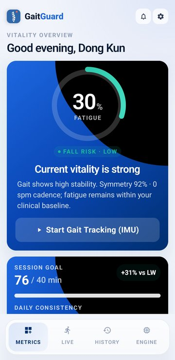
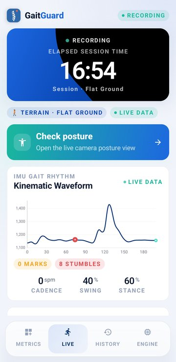
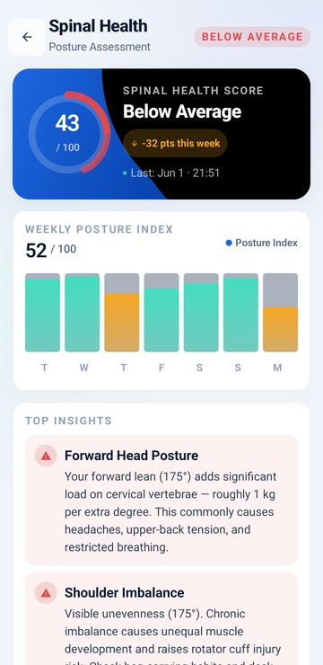
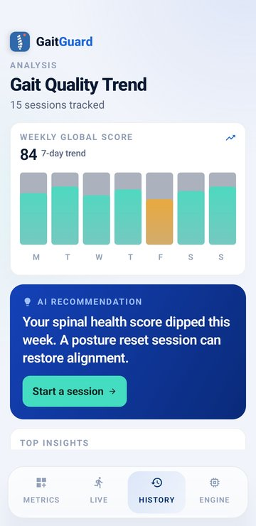
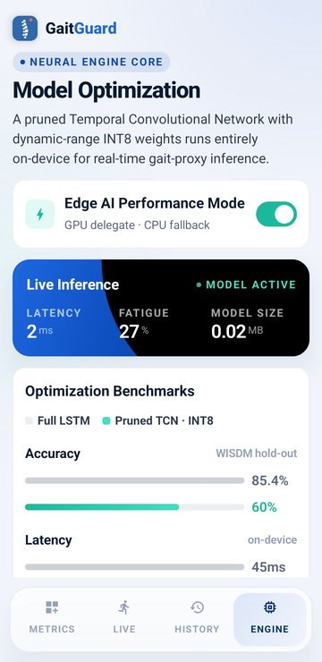

<p align="center">
  
</p>

<h1 align="center">GaitGuard</h1>

<p align="center">
  Real-time gait, posture and fatigue monitoring on Android, with all machine learning running on the device.
</p>

<p align="center">
  
  
  
  
  
  
</p>

<p align="center">
  
  
  
  
  
</p>

GaitGuard turns a phone into a gait lab. While you walk, it samples the
accelerometer and gyroscope at 50 Hz, extracts cadence, symmetry and stability
features, and runs a pruned, INT8-quantised Temporal Convolutional Network
(25 KB) to estimate fatigue and fall risk. Separately, it uses the camera with
ML Kit pose detection to score spinal posture. Sessions are stored locally with
Room for history, replay, PDF reports and CSV export.

Built for *Mobile Computing and Its Applications* at Seoul National University
(2026). It covers the full mobile ML pipeline: sensing, signal processing,
on-device inference, persistence, camera vision, alerts and model compression.

> **Not a medical device.** Fatigue and fall-risk outputs come from a model
> trained on public-dataset *proxy* labels (see [Limitations](#limitations)).

## Feature Tour

- **Metrics dashboard:** first screen after calibration. Shows current gait state, daily/weekly activity summaries, global gait score, recent sessions, and quick links into live monitoring, settings, and history.
- **Live gait monitoring:** starts/stops a walking session, plots the vertical acceleration waveform, shows fatigue, fall-risk, cadence, symmetry, terrain, marked events, and fall alerts.
- **Posture analysis:** uses CameraX and ML Kit Pose Detection for live posture analysis, gallery/image capture, posture cues, and a posture result screen.
- **Walk Test:** runs a guided 6-minute walk test using the same gait session pipeline and live summary metrics.
- **History and replay:** stores sessions locally with Room, shows trends, lets the user inspect past sessions, and replays fatigue/symmetry/cadence timelines.
- **Engine screen:** explains the model optimization path, reads `assets/benchmark.md`, reloads the deployed model, and shows benchmark comparisons.
- **Settings and calibration:** handles gravity/baseline calibration, dark mode, alert settings, user profile display name, local data reset, and walk-test entry.

## Architecture

The app is a single Android module under `app/`.

- **UI layer:** Jetpack Compose screens live in `app/src/main/java/com/gaitguard/app/ui/screens/`. Shared cards, charts, gauges, navigation, and theme components live in `ui/components/`, `ui/navigation/`, and `ui/theme/`.
- **ViewModels:** `GaitViewModel`, `HistoryViewModel`, and `PostureViewModel` expose state flows for Compose screens and coordinate user actions.
- **Repositories:** `GaitRepository` and `PostureRepository` connect sensors, ML engines, Room DAOs, and app-level flows.
- **Sensor pipeline:** `GaitSensorManager` collects accelerometer and gyroscope data, aligns coordinates, buffers samples, classifies terrain, detects falls/micro-stumbles, and emits processed windows.
- **Signal processing:** `SignalProcessor`, `FftProcessor`, `ButterworthFilter`, and related helpers extract cadence, inter-step interval variation, symmetry, dominant frequency, harmonic ratio, band energy, trunk tilt, arm-swing proxy, and the 12-element feature vector used by TFLite.
- **ML engines:** `GaitInferenceEngine` loads `app/src/main/assets/gait_model.tflite` with a GPU delegate when available and falls back to CPU. `PostureAnalyzer` runs ML Kit pose detection and computes posture metrics.
- **Persistence:** Room stores `SessionRecord`, `FatigueTimelinePoint`, and `PostureSnapshot` entities through DAOs in `data/db/`.
- **Utilities:** SMS alerts, PDF report generation, CSV export, demo data seeding, user profile storage, and WorkManager trend checks live in `app/src/main/java/com/gaitguard/app/util/`.

Application startup is handled by `GaitGuardApplication`: it initializes the Room singleton, seeds demo data if needed, creates notification channels, and schedules the daily trend-check worker. `MainActivity` requests runtime permissions and launches `AppNavigation`.

## Runtime Data Flow

### Gait Flow

1. `MainActivity` requests camera, SMS, location, vibration, and notification permissions where required by the Android version.
2. `AppNavigation` creates the shared ViewModels and routes users through calibration before normal dashboard use.
3. `GaitViewModel.startSession()` calls into `GaitRepository`, which starts `GaitSensorManager`.
4. `GaitSensorManager` samples accelerometer and gyroscope data, aligns the phone coordinate frame, pushes samples through a ring buffer, and processes 4-second windows at 50 Hz.
5. `SignalProcessor` produces `ProcessedFeatures`: gait metrics, waveform data, step timestamps, and a normalized 12-element hand-feature vector.
6. `GaitInferenceEngine.runInference()` sends two inputs to TFLite: the 12 hand features and the 200 x 6 IMU window.
7. TFLite outputs fatigue probability, 3-class fall-risk distribution, and symmetry probability. The app combines these with signal-derived metrics into `GaitResult`.
8. The UI updates through `StateFlow`, while the repository persists session summaries and timeline points in Room.

If the model cannot load, the app still produces signal-only gait metrics so the UI remains usable.

### Posture Flow

1. `PostureScreen` binds CameraX through `PostureViewModel`.
2. `PostureAnalyzer` receives camera frames or gallery images and runs ML Kit accurate pose detection on-device.
3. Detected landmarks are converted into shoulder-level angle, kyphosis angle, pelvic tilt, asymmetry, axial alignment, confidence, and a composite spinal health score.
4. `PostureRepository` stores posture snapshots, including optional photo URIs, for the posture health/history views.

## Model Pipeline

The model training and optimization script is `model/train.py`.

It performs the following steps:

1. Loads WISDM v1.1 walking data and the UCI-HAR walking subset. If a dataset cannot be downloaded or read, the script falls back to synthetic gait-like IMU data for offline testing.
2. Segments data into 200-sample windows with 50% overlap.
3. Creates fatigue-proxy labels from temporal position: first 60% of a walking stream is normal/fresh proxy, last 40% is fatigue proxy.
4. Extracts the same 12 hand-crafted features expected by the Android runtime.
5. Trains a full LSTM baseline.
6. Trains an unoptimized dual-input TCN with explicit causal padding and Conv1D blocks.
7. Applies TensorFlow Model Optimization pruning with a polynomial schedule from 50% to 85% sparsity and fine-tunes for 25 epochs.
8. Exports a dynamic-range INT8 TFLite model. Eligible weights are stored as INT8, while activations and app-facing input/output tensors remain float32 for Android TensorFlow Lite 2.16.1 compatibility.
9. Verifies the exported TFLite artifact has INT8 tensors and compatible operator versions.
10. Copies the final live model to `app/src/main/assets/gait_model.tflite` and writes both `model/benchmark.md` and `app/src/main/assets/benchmark.md`.

Current deployed model:

- Live asset: `app/src/main/assets/gait_model.tflite`
- Source optimized artifact: `model/tcn_int8.tflite`
- Input concept: 4-second IMU window, shape 200 x 6, plus 12 engineered gait features.
- Output concept: fatigue proxy, fall-risk distribution, and symmetry proxy.

Current TFLite artifacts:

| Artifact | Size | Purpose |
|---|---:|---|
| `model/lstm_baseline.tflite` | 145,380 bytes | Baseline comparison model |
| `model/tcn_full.tflite` | 44,040 bytes | Unoptimized TCN comparison |
| `model/tcn_pruned.tflite` | 44,040 bytes | Pruned float32 TCN |
| `model/tcn_int8.tflite` | 25,200 bytes | Dynamic-range INT8 model copied into app assets |

## Benchmark

The app and README should match `model/benchmark.md`.

| Metric | Full LSTM (baseline) | TCN (unoptimized) | Pruned TCN | Pruned TCN INT8 |
|---|---|---|---|---|
| Fatigue-proxy accuracy - WISDM v1.1 hold-out | 85.4% | 60.0% | 60.0% | 60.0% |
| Fatigue-proxy accuracy - UCI-HAR hold-out | 40.0% | 58.5% | 60.0% | 60.0% |
| Model size | 0.14 MB | 0.04 MB | 0.04 MB | 0.02 MB |
| Size reduction vs unoptimized TCN | - | - | 0% | 43% |
| Inference latency (Galaxy S22)\* | 45 ms | 30 ms | 18 ms | 18 ms |

\* Latency values are fixed figures written into `model/train.py`; the training
script does not measure them. The in-app Engine screen reports real on-device
inference and warm-up latency.

Benchmark notes:

- Primary dataset: WISDM v1.1 walking segments.
- Secondary sanity check: UCI-HAR walking subset.
- Window: 200 samples at 50 Hz, 50% overlap.
- Accuracy is for the public-dataset fatigue proxy task, not clinical fatigue diagnosis.
- Size reduction is relative to the unoptimized TCN of the same architecture.

## Build, Run, And Retrain

### Android Requirements

- Android Studio with a recent Android SDK.
- Java 17.
- Android Gradle Plugin 8.7.3.
- Kotlin 2.0.21.
- Compile SDK 35, target SDK 35, min SDK 29.
- A device or emulator. A physical device is recommended for IMU, camera, SMS, and vibration behavior.

### Build From Source

On Windows:

```powershell
.\gradlew.bat assembleDebug
```

On macOS/Linux:

```bash
./gradlew assembleDebug
```

The debug APK is generated under `app/build/outputs/apk/debug/`.

### Install On A Device

```bash
./gradlew installDebug
```

APKs are not committed to the repository; build one locally as shown above.

### Retrain Or Re-Export The Model

```bash
python model/train.py
```

The script writes:

- `model/lstm_baseline.tflite`
- `model/tcn_full.tflite`
- `model/tcn_pruned.tflite`
- `model/tcn_int8.tflite`
- `model/benchmark.md`
- `app/src/main/assets/gait_model.tflite`
- `app/src/main/assets/benchmark.md`

Python dependencies are TensorFlow, TensorFlow Model Optimization, NumPy, and the standard-library download/archive tools used by the script.

## Permissions And Assets

Android permissions declared in `AndroidManifest.xml`:

- `CAMERA` for posture analysis.
- `SEND_SMS` for caregiver/fall-risk alert hooks.
- `ACCESS_FINE_LOCATION` and `ACCESS_COARSE_LOCATION` for SMS alert location context.
- `VIBRATE` for local alert feedback.
- `POST_NOTIFICATIONS` on Android 13+ for trend/fall notifications.
- `SCHEDULE_EXACT_ALARM` up to Android 12 for scheduled trend checks.

Hardware features are marked `required=false` so the app can install on devices without every sensor/camera feature, though the live gait and posture flows work best with accelerometer, gyroscope, and camera hardware.

Bundled runtime assets:

- `app/src/main/assets/gait_model.tflite`: deployed dynamic-range INT8 gait model.
- `app/src/main/assets/benchmark.md`: benchmark table read by the Engine screen.

The Gradle config disables compression for `.tflite` and `.lite` files so TensorFlow Lite can memory-map the model.

## Repository Map

```text
app/
  build.gradle.kts                         Android module config and dependencies
  src/main/AndroidManifest.xml             permissions, app class, activity, FileProvider
  src/main/assets/                         deployed TFLite model and benchmark markdown
  src/main/java/com/gaitguard/app/
    MainActivity.kt                        runtime permission request and Compose entrypoint
    GaitGuardApplication.kt                Room warmup, demo seed, notification channels, worker scheduling
    data/db/                               Room entities and DAOs
    data/model/                            GaitResult, PostureResult, TerrainType
    data/repository/                       gait and posture repository orchestration
    ml/                                    TFLite gait inference and ML Kit posture analysis
    sensor/                                IMU collection, signal processing, fall detection, terrain classification
    ui/components/                         shared Compose UI building blocks
    ui/navigation/                         NavHost and route graph
    ui/screens/                            app screens
    ui/theme/                              colors, typography, dark mode theme
    util/                                  alerts, reports, export, filters, constants, demo data, profile, workers
model/
  train.py                                 training, pruning, quantization, benchmark generation
  benchmark.md                             current model benchmark table
  *.tflite                                 baseline, unoptimized, pruned, and INT8 artifacts
docs/screenshots/                          README screenshots
Mobile presentation/                       offline HTML slide deck with demo videos
presentation/, project_proposal/           course presentation and proposal
gradle/
  libs.versions.toml                       AGP, Kotlin, and KSP plugin versions
```

## Limitations

- The fatigue labels are proxy labels from temporal position within walking streams, not medically validated fatigue annotations.
- With a 60/40 label split, the TCN variants' 60.0% accuracy matches the majority-class rate, so the compact model is not yet learning the proxy task. The optimisation results show size and speed, not predictive gains.
- The hold-out split is stratified at random over 50%-overlapping windows, so neighbouring windows can appear in both train and test; the LSTM's 85.4% WISDM accuracy is likely optimistic. A subject- or stream-level split would give a fairer estimate.
- Public datasets used here do not contain the exact real-world target signal for clinical fatigue detection.
- WISDM has accelerometer data; gyroscope channels are zero-padded in the training loader.
- Real hardware behavior depends on where the phone is carried, sensor quality, calibration quality, and whether the user grants the required permissions.
- SMS/location alert behavior depends on device permissions, SIM/network availability, and Android policy restrictions.
- The model optimization work demonstrates on-device deployment and compression; it should not be interpreted as clinical validation.

## Quick Sanity Checks For Developers

```bash
# Build the Android app
./gradlew assembleDebug

# Regenerate model artifacts and benchmarks
python model/train.py

# Confirm README benchmark source
cat model/benchmark.md
```

On Windows PowerShell, use `.\gradlew.bat assembleDebug` instead of `./gradlew assembleDebug`.

## License

[MIT](LICENSE) © Dongkun Moon
